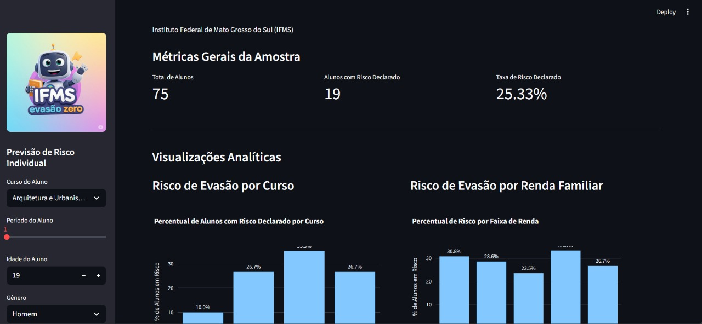
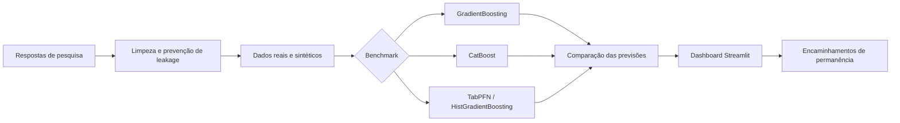

<div align="center">


# Evasão Zero

### Inteligência de dados para fortalecer a permanência estudantil

Sistema de análise, predição e encaminhamento para apoiar instituições de ensino
na identificação precoce de sinais associados à evasão.

<p>
  <a href="https://github.com/KatSilvax/project-tcc">
    
  </a>
  
  
  
  <a href="LICENSE">
    
  </a>
</p>

</div>

---

## O problema

A evasão raramente acontece de forma repentina. Antes do abandono, podem aparecer
sinais relacionados a renda, trabalho, deslocamento, acesso a auxílios e
dificuldades de adaptação acadêmica.

O **Evasão Zero** transforma esses sinais em informação acionável. A plataforma
combina três modelos de machine learning, visualizações interativas e sugestões
de encaminhamento para políticas de permanência. O objetivo não é rotular ou
punir estudantes: é ajudar a equipe responsável a chegar mais cedo, com mais
contexto e com uma rede de apoio mais bem direcionada.

> **Predição responsável:** os resultados são estimativas de apoio à decisão.
> Não substituem entrevista, análise socioeconômica, avaliação pedagógica,
> atendimento psicossocial ou os critérios oficiais de cada programa.

## O que torna o projeto especial

| Recurso | Entrega |
|---|---|
| **Visão integrada** | Indicadores, gráficos, previsões e encaminhamentos em uma única interface |
| **Comparação simultânea** | GradientBoosting, CatBoost e TabPFN/HistGradientBoosting analisam o mesmo perfil |
| **Ação depois da previsão** | Além do risco, o sistema sugere apoios como permanência, alimentação, transporte e acompanhamento |
| **Interface para decisão** | Dashboard com logo, KPIs, abas, gráficos interativos e tabela por estudante |
| **Pipeline científico** | Benchmark com validação cruzada, cenário real e cenário Train on Synthetic, Test on Real |
| **Privacidade por construção** | O fluxo de modelagem remove variáveis de justificativa pós-fato para reduzir vazamento de informação |

## Veja a plataforma

<div align="center">



*Dashboard Evasão Zero — análise visual de risco e permanência estudantil.*

</div>

### Experiência no dashboard

- **Visão geral:** panorama da base, risco médio por curso e por faixa de renda.
- **Modelos:** comparação lado a lado dos três modelos, com taxa de risco e probabilidade média.
- **Políticas públicas:** apoios mais indicados e fontes oficiais para consulta.
- **Estudantes:** resultado detalhado por perfil, com probabilidade de cada modelo e políticas sugeridas.
- **Simulador individual:** preenchimento de um perfil para obter as três previsões em tempo real.
- **Turmas externas:** upload opcional de CSV com as sete variáveis de entrada.

## Como funciona



### Variáveis analisadas

Os modelos utilizam sete variáveis de entrada:

- curso;
- período;
- faixa etária;
- cidade de origem;
- renda familiar;
- situação de trabalho;
- recebimento ou solicitação de auxílio institucional.

No treinamento, a variável-alvo `risco_evasao` é derivada de `ja_pensou_em_desistir`.
As colunas `motivo_de_desistencia` e `motivo_agrupado` são removidas do fluxo de
predição para evitar o uso de informações que podem representar um evento já
ocorrido ou uma justificativa posterior.

## Modelos comparados

| Modelo | Papel no projeto | Característica |
|---|---|---|
| **GradientBoosting (Baseline)** | Linha de base | Pipeline com imputação, codificação categórica e busca interna de hiperparâmetros |
| **CatBoost (SOTA)** | Modelo especializado | Trata variáveis categóricas nativamente e usa balanceamento de classes |
| **TabPFN / HistGB (SOTA)** | Modelo avançado | Usa TabPFN quando disponível e possui fallback para HistGradientBoosting |

O dashboard exibe os três resultados simultaneamente. Assim, a equipe pode
observar consenso, divergência e probabilidade média sem precisar alternar
manualmente entre modelos.

## Resultados do benchmark

Os valores abaixo vêm de `resultados_benchmark_tcc.csv` e representam média ±
desvio-padrão em validação cruzada.

### Cenário A — treino e teste em dados reais

| Modelo | ROC-AUC | F1 macro | Recall | Precisão |
|---|---:|---:|---:|---:|
| CatBoost | 0,609 ± 0,097 | 0,598 ± 0,029 | 0,574 ± 0,096 | 0,486 ± 0,037 |
| GradientBoosting | 0,603 ± 0,086 | 0,572 ± 0,085 | 0,435 ± 0,131 | 0,474 ± 0,130 |
| TabPFN / HistGB | 0,603 ± 0,047 | 0,584 ± 0,093 | 0,602 ± 0,132 | 0,467 ± 0,092 |

### Cenário B — dados sintéticos SDV

| Modelo | ROC-AUC | F1 macro | Recall | Precisão |
|---|---:|---:|---:|---:|
| CatBoost | 0,608 ± 0,102 | 0,577 ± 0,130 | 0,573 ± 0,156 | 0,470 ± 0,148 |
| TabPFN / HistGB | 0,576 ± 0,124 | 0,539 ± 0,106 | 0,531 ± 0,186 | 0,417 ± 0,119 |
| GradientBoosting | 0,561 ± 0,136 | 0,535 ± 0,086 | 0,231 ± 0,136 | 0,577 ± 0,210 |

> Esses resultados são experimentais e não devem ser interpretados como
> garantia de desempenho em uma nova instituição. A implantação responsável
> exige validação com dados institucionais, acompanhamento de vieses,
> calibração e avaliação com a equipe pedagógica.

## Políticas e apoios sugeridos

O sistema conecta sinais do perfil a possíveis caminhos de permanência:

- **Pé-de-Meia:** incentivo financeiro-educacional voltado ao público elegível
  do ensino médio público, conforme regras oficiais;
- **auxílio permanência:** suporte socioeconômico para despesas que dificultam
  a continuidade no curso;
- **alimentação e refeição:** auxílio alimentação, restaurante estudantil ou
  oferta equivalente, conforme a unidade;
- **auxílio transporte:** apoio para deslocamento, conforme edital;
- **apoio psicossocial:** acolhimento e acompanhamento multiprofissional;
- **apoio pedagógico:** monitoria, reforço, orientação e acompanhamento
  acadêmico.

O dashboard apresenta links de consulta, mas a concessão deve seguir os
critérios oficiais, editais vigentes, documentação e avaliação da instituição.

## Executar localmente

### Pré-requisitos

- Python 3.9 ou superior;
- Git;
- `uv` (recomendado) ou `pip`;
- credenciais AWS configuradas apenas se os artefatos locais não estiverem
  disponíveis e o dashboard precisar baixá-los do S3.

### Instalação com `uv`

```powershell
git clone https://github.com/KatSilvax/project-tcc.git
cd project-tcc
uv sync
```

### Instalação com `pip`

```powershell
pip install -r requirements.txt
```

### Iniciar o dashboard

```powershell
uv run streamlit run deployments/dashboard/app.py
```

Ou:

```powershell
streamlit run deployments/dashboard/app.py
```

Depois, abra `http://localhost:8501`.

## Reproduzir o pipeline

### 1. Gerar dados sintéticos

O script utiliza SDV para gerar uma base sintética com as variáveis de
modelagem, sem carregar as justificativas removidas por risco de leakage:

```powershell
uv run python scripts/01_gerar_dados.py
```

### 2. Executar o benchmark

O benchmark treina, avalia e salva os modelos, resultados e figuras:

```powershell
uv run python scripts/02_benchmark_modelos_tcc.py
```

Saídas principais:

- `models/gb_baseline_ifms.joblib`;
- `models/catboost_sota_ifms.joblib`;
- `models/tabpfn_sota_ifms.joblib`;
- `models/modelo_evasao_ifms.joblib`;
- `resultados_benchmark_tcc.csv`;
- `figures/tcc/`.

### 3. Publicar os artefatos no S3

Configure suas credenciais AWS no ambiente e execute:

```powershell
$env:EVASAO_BUCKET = "seu-bucket"
uv run python scripts/03_upload_s3.py
```

O script publica a base sintética e os três modelos no bucket configurado. A
variável `EVASAO_BUCKET` define o nome do bucket usado pelo upload e pelo
dashboard. Se ela não for definida, o projeto mantém como padrão
`evasao-zero-dados-ifms-katy-849275`.
Nunca coloque chaves AWS, tokens ou arquivos `.env` no repositório.

## Estrutura do projeto

```text
evasao-zero/
├── assets/
│   ├── dashboard.jpg              # Captura visual da aplicação
│   └── logo.jpg                   # Identidade visual Evasão Zero
├── data/
│   ├── Respostas_evasao_limpo.csv # Base de respostas para modelagem
│   └── dados_sinteticos_ifms.csv  # Base sintética usada pelo dashboard
├── deployments/dashboard/
│   └── app.py                     # Aplicação Streamlit
├── figures/tcc/                   # Curvas, calibração, SDV e SHAP
├── models/                        # Artefatos joblib treinados
├── notebooks/
│   └── 01_limpeza_e_analise.ipynb # Análise exploratória
├── scripts/
│   ├── 01_gerar_dados.py          # Síntese com SDV
│   ├── 02_benchmark_modelos_tcc.py# Benchmark científico
│   ├── 03_upload_s3.py             # Publicação no S3
│   ├── 04_robustez_basica.py       # IC, Brier, Wilcoxon e confusão
│   ├── 05_robustez_limiar_calibracao_sintese.py
│   │                                # Limiar, calibração e sensibilidade SDV
│   ├── 06_robustez_explicabilidade_subgrupos.py
│   │                                # SHAP, permutação e subgrupos
│   └── 07_gerar_resumo_robustez.py # Resumo cauteloso em Markdown
├── src/
│   ├── model_wrapper.py             # Classes importáveis dos modelos
│   ├── regras.py                    # Regras puras do dashboard e testes
│   └── robustez_utils.py            # Utilitários compartilhados de robustez
├── tests/
│   └── test_basico.py               # Testes unitários e de integração leve
├── pyproject.toml
├── requirements.txt
└── uv.lock
```

## Qualidade, ética e limitações

Este projeto é uma ferramenta de apoio à decisão, não um sistema automático de
seleção de beneficiários. Para uso institucional, recomenda-se:

1. validar o modelo com dados representativos da instituição;
2. medir desempenho por curso, campus, faixa de renda e outros grupos;
3. revisar falsos positivos e falsos negativos com profissionais da área;
4. informar estudantes sobre o uso responsável dos dados;
5. aplicar minimização, controle de acesso e anonimização;
6. revisar periodicamente as regras de políticas públicas;
7. registrar a decisão humana posterior à recomendação.

Os dados disponíveis neste repositório são anonimizados e/ou sintéticos para
desenvolvimento e demonstração. O projeto não deve ser usado para tomar
decisões irreversíveis sobre estudantes sem análise humana qualificada.

## Pesquisa e artefatos científicos

As figuras produzidas pelo benchmark estão em [`figures/tcc/`](figures/tcc/):

- curva ROC comparativa;
- curva de calibração e Brier score;
- comparação real versus sintético;
- importância global com SHAP;
- resumo SHAP em formato beeswarm.

O arquivo [`resultados_benchmark_tcc.csv`](resultados_benchmark_tcc.csv) contém
as métricas consolidadas dos experimentos.

## Robustez estatística e rastreabilidade

Os experimentos adicionais foram separados do benchmark original para medir a
incerteza sem sobrescrever resultados anteriores:

| Script | Escopo | Principais saídas |
|---|---|---|
| `scripts/04_robustez_basica.py` | RepeatedStratifiedKFold, IC95% bootstrap, Brier Skill Score, Wilcoxon com Holm e matrizes de confusão | `resultados_robustez_base.csv`, `resultados_robustez_basica.csv`, `resultados_robustez_testes.csv`, `resultados_robustez_confusao.csv` |
| `scripts/05_robustez_limiar_calibracao_sintese.py` | Limiar escolhido dentro do treino, calibração sigmoid/isotonic e 0/250/500/1000/2000 sintéticos por fold | `resultados_robustez_limiar.csv`, `resultados_robustez_calibracao.csv`, `resultados_robustez_sintese.csv` |
| `scripts/06_robustez_explicabilidade_subgrupos.py` | Importância por permutação, SHAP, estabilidade de ranking e desempenho por subgrupos | `resultados_robustez_importancia.csv`, `resultados_robustez_subgrupos.csv`, `resultados_robustez_rastreabilidade.csv` |
| `scripts/07_gerar_resumo_robustez.py` | Consolidação cautelosa dos CSVs de robustez | `resultados_robustez_resumo.md` |

As figuras desses experimentos usam o prefixo `rob_` em `figures/tcc/`. A
validação reduzida foi executada com `--repeticoes 1`; a análise completa
requer mais repetições e não deve ser interpretada como validação externa.
Quando `tabpfn` não está instalado ou a memória disponível é insuficiente, o
terceiro modelo é registrado como fallback `HistGradientBoosting`.

### Testes automatizados

Execute:

```powershell
uv run pytest -q
```

A suíte cobre a criação do alvo, políticas recomendadas, schema das sete
colunas obrigatórias do upload e carregamento dos modelos quando os artefatos
estão disponíveis. Na última validação, foram aprovados 14 testes.

## Contribuição

Sugestões, correções e melhorias são bem-vindas:

1. faça um fork do projeto;
2. crie uma branch para sua alteração;
3. implemente e documente a mudança;
4. execute as validações pertinentes;
5. abra um pull request descrevendo o impacto.

## Licença

Distribuído sob a licença MIT. Consulte [`LICENSE`](LICENSE).

---

<div align="center">

**Evasão Zero — tecnologia para transformar sinais em cuidado.**

</div>
